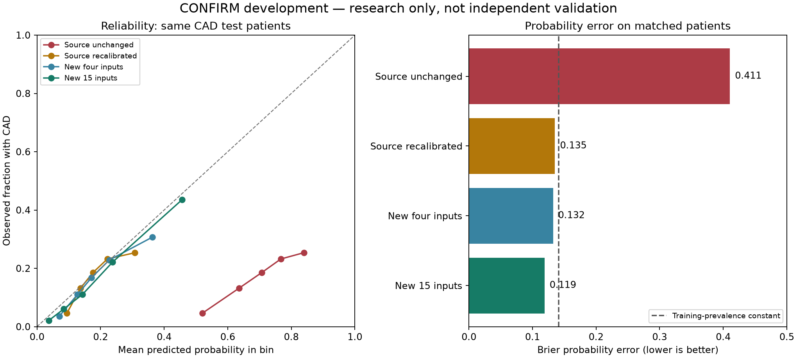

# CONFIRM development improvements

Completed 8 October 2026. **Separate research models only; the app and the original external experiment are unchanged.**

This experiment follows the negative external transport result. CONFIRM is now development data. These are internal test results from a previously inspected registry, not fresh independent validation or evidence of clinical readiness.

## What changed

- Recalibrated the frozen four-input source model using a dedicated CONFIRM calibration partition.
- Trained new models on more records and compared logistic, additive spline, histogram boosting and random forest pipelines using training-only cross-validation.
- Tested 11 additional nominal clinical fields on exactly the same complete-case patients, then tested missing-input handling in a separately reported wider cohort.
- Froze diagnostic cutoffs targeting 90% sensitivity on calibration rows, and measured the resulting false alarms and misses on test rows.

Before missing outcomes are excluded: 7,100 complete-case records and 14,257 available-input records. The wider cohort partitions contain 8,574 training, 2,863 calibration and 2,820 test rows. Every registry ID has the same partition across all arms and targets. Neither model selection nor calibration uses test labels.

## Matched complete-case comparison

All columns for a target use the same test patients. Brier measures probability error (lower is better); AUC measures ranking (higher is better). The constant baseline uses training prevalence. New-model values below are after the prespecified calibration step; raw results are retained in JSON.

| Target | Test n | Source AUC / Brier | Source recalibrated AUC / Brier | New four-input AUC / Brier | New 15-input AUC / Brier | Constant Brier |
|---|---:|---:|---:|---:|---:|---:|
| CAD | 1,402 | 0.658 / 0.411 | 0.658 / 0.135 | 0.699 / 0.132 | 0.789 / 0.119 | 0.141 |
| LAD | 1,398 | 0.641 / 0.301 | 0.641 / 0.109 | 0.700 / 0.106 | 0.785 / 0.098 | 0.112 |
| LCX | 1,396 | 0.645 / 0.163 | 0.645 / 0.056 | 0.707 / 0.055 | 0.802 / 0.053 | 0.057 |
| RCA | 1,402 | 0.609 / 0.167 | 0.609 / 0.068 | 0.709 / 0.067 | 0.793 / 0.063 | 0.069 |

For matched CAD test patients, average predicted probability changed from 69.4% to 19.2%; observed prevalence was 17.0%. Average agreement alone is insufficient: the reliability chart and bin tables show how probabilities vary across risk groups.

## Additional-feature comparison uncertainty

Paired 500-resample row bootstrap, calibrated 15-input minus calibrated four-input model on the same patients. Positive AUC and negative Brier differences favor additional fields. These intervals condition on the fitted pipelines, omit site clustering and training/selection uncertainty, and are not adjusted for multiple comparisons.

| Target | AUC difference 95% interval | Brier difference 95% interval |
|---|---:|---:|
| CAD | +0.061 to +0.118 | -0.0185 to -0.0078 |
| LAD | +0.053 to +0.118 | -0.0121 to -0.0046 |
| LCX | +0.045 to +0.142 | -0.0048 to -0.0006 |
| RCA | +0.031 to +0.130 | -0.0069 to -0.0005 |

## Wider coverage, separately evaluated

Missing BMI/LDL/HDL is imputed using training-only medians with missingness indicators. Age is required. Observed out-of-bounds values and prior/unknown MI/PCI/CABG remain excluded. This is a different patient mix; its performance cannot be treated as a matched improvement over the complete-case experiment.

| Target | Train / calibration / test | Selected family | AUC | Brier / constant Brier | Predicted / observed prevalence |
|---|---:|---|---:|---:|---:|
| CAD | 8,565 / 2,855 / 2,818 | splines | 0.788 | 0.125 / 0.152 | 19.4% / 18.7% |
| LAD | 8,529 / 2,840 / 2,802 | splines | 0.784 | 0.105 / 0.122 | 15.2% / 14.2% |
| LCX | 8,432 / 2,801 / 2,770 | logistic | 0.793 | 0.058 / 0.063 | 6.1% / 6.7% |
| RCA | 8,510 / 2,827 / 2,789 | logistic | 0.777 | 0.068 / 0.075 | 8.1% / 8.1% |

## Cutoff tradeoff on the wider cohort

The diagnostic cutoff was selected on calibration patients to reach at least 90% sensitivity there. It is not a recommended clinical threshold; test sensitivity can fall below 90%. The fixed .5 results remain in the full evidence to avoid hiding poor sensitivity at default classification.

| Target | Cutoff | Test sensitivity | Specificity | Missed cases / positives | False alarms / negatives |
|---|---:|---:|---:|---:|---:|
| CAD | 0.099 | 93.5% | 38.3% | 34 / 527 | 1413 / 2291 |
| LAD | 0.079 | 93.7% | 36.4% | 25 / 398 | 1528 / 2404 |
| LCX | 0.031 | 91.9% | 44.2% | 15 / 186 | 1441 / 2584 |
| RCA | 0.040 | 89.4% | 44.1% | 24 / 227 | 1433 / 2562 |

## Decision and limitations

Keep these as separate research candidates. More appropriate training data and calibration can address the measured failure, but the experiment does not validate the 55-input app or demonstrate reliable use in another population. The original source-only transport failure remains preserved.

The 15 inputs comprise age, BMI, LDL, HDL and opaque nominal codes for sex, hypertension, diabetes, cholesterol history, family history, current/past smoking, chest pain, typicality, exertion and shortness of breath. Category meanings have not been guessed or converted into a user-facing input form. Authoritative code definitions and availability before the prediction point remain review requirements. CT calcium, imaging function, stenosis and follow-up fields are excluded from predictors.

This random patient split does not test a new site or time period. Input missingness can encode site/workflow differences; the wider-cohort missingness subgroup is descriptive, not a transportability guarantee. Subgroup metrics by age, sex code and missing numeric input are saved, with small/single-class groups suppressed. CCTA labels and the original invasive-angiography labels have different reference standards. The inherited endpoint mapping is inferred from headers, papers and internal consistency, without a formal workbook codebook.

Next evidence step: a genuinely unused, compatible cohort with reviewed field definitions and prediction timing. Do not optimize against these test results and call the next pass independent validation.

## Artifacts and reproduction

- Protocol: [frozen development design](confirm_development_protocol.md).
- Runner stages: `python scripts/develop_confirm.py prepare`, then `fit`, then `evaluate`. Each refuses to overwrite its outputs.
- Saved pipelines, calibration models, partitions, CV losses, cutoffs, test predictions, bin/subgroup tables and hashes: `ml/experiments/confirm_development_v1/`.
- Read-only evidence checks: `python -m pytest tests/test_confirm_development.py tests/test_confirm_external.py -q`.
- Verification on the delivered artifacts: **8 passed**. These audit both experiment manifests, source/app preservation, partition separation, selected-family rules, calibration-only cutoffs, reproduced metrics, training-only imputation and serialized-model predictions. One read-only workbook-extension warning; no workbook was saved.
- Plot/report reproduction: `python scripts/report_confirm_development.py`.
- [CONFIRM data, Filippo Cademartiri, CC BY 4.0](https://data.mendeley.com/datasets/shntp48zv9/1). Raw workbook and registry IDs are excluded from the source bundle.
- Methods: [probability calibration](https://scikit-learn.org/stable/modules/calibration.html), [threshold selection](https://scikit-learn.org/stable/modules/classification_threshold.html).

