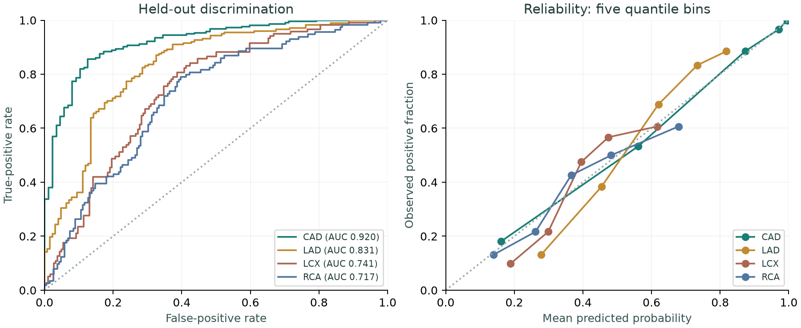
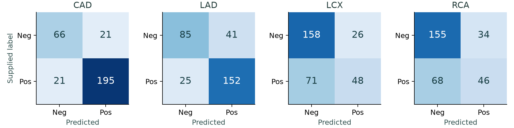
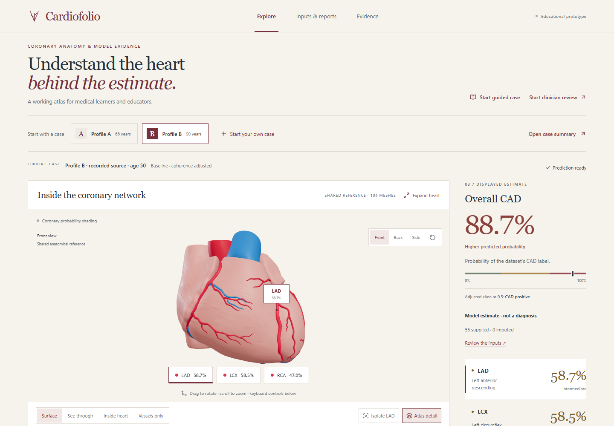

# Cardiofolio

Track A - Cardiovascular Risk Visualization & Prediction. Multimodal AI Hackathon 2026. Technical report, updated 15 October 2026.

## 1. Problem and claim boundary

Cardiofolio connects four tabular classification models to an interactive anatomical reference and model-specific explanations. The input workflow accepts demographic, clinical, ECG, laboratory and echocardiographic observations. Outputs estimate the dataset's overall CAD and LAD/LCX/RCA stenosis labels.

The application distinguishes prediction, association, visualization and diagnosis. A 70% vessel probability is not 70% narrowing, a future-event risk score or a localized blockage. Geometry is a shared atlas; it never represents a patient's imaging. The software is an educational/research prototype, not a substitute for professional diagnosis, coronary angiography or other diagnostic imaging.

## 2. Dataset and audit

We downloaded the original UCI Extension of Z-Alizadeh Sani workbook [1], preserved it unchanged and recorded its SHA256. The populated sheet contains 303 rows, 59 columns and 55 permitted inputs. Positive labels: CAD 216, LAD 177, LCX 119, RCA 114. No missing cells, exact duplicate rows or duplicate feature vectors were found. The second sheet has no records; its medication and segment-level headings do not supply additional measurements.

One record (zero-based 93; worksheet row 95) has LAD Stenotic but Cath Normal. Supplied labels are retained. Exertional CP is constant; CHF has one positive and LowTH Ang two. Age spans 30-86. Large TG and platelet values are retained as source observations, not automatically removed. Weight/BMI correlation is 0.725 and Lymph/Neut -0.923. Clinical acquisition timing and a complete unit dictionary are unavailable. Conventional units are visibly qualified in the UI.

## 3. Preprocessing and system architecture

An explicit input allowlist excludes LAD, LCX, RCA and Cath from every task. Numeric fields receive median imputation and standardization; categories receive mode imputation and one-hot encoding with unknown-category tolerance inside sklearn pipelines. All learned transformations are fitted within training folds. The source spelling Fmale is preserved internally and displayed as Female. No oversampling, full-data feature selection or outcome-driven outlier removal is used. Constant columns are retained; no global constant-selection step changes the model input set.

React/TypeScript/Vite communicates with a stateless FastAPI API. Pydantic validates request structure and response probabilities; canonical feature metadata supplies the form and backend validator. Invalid categories, unknown/prohibited fields, nonfinite values and insufficient input return errors. Missing observations are imputed and explicitly disclosed. Editing inputs clears old results. Models, dataset and anatomical files have integrity manifests.

<!-- PAGEBREAK -->

## 4. Model architecture and validation

Four independent binary tasks share preprocessing but select classifiers separately. Candidates are L2 logistic regression (C=0.03 or 0.3), random forest (120 trees, minimum leaf 5) and gradient boosting (80 trees, depth 2, learning rate 0.035, minimum leaf 8). Seed: 20261007. CPU execution suffices. Later pretrained tabular-model research is documented separately on page 6.

Each task uses five stratified outer folds. Within each outer training partition, three stratified inner folds select the highest mean ROC-AUC configuration. The selected pipeline is refitted on that outer training partition and predicts only its held-out rows. All 303 out-of-fold predictions, fold indices and candidate scores are saved. The fixed classification threshold is 0.5. A training-fold prevalence predictor provides a baseline.

After outer evaluation, a separate three-fold selection over all data determines the deployable model, then refits it on all rows. Final choices are forests for CAD/LCX and logistic regression (C=0.03) for LAD/RCA. Outer metrics evaluate the original raw-model selection procedure; they are not independent evaluation of these final refits or the later adjusted display. Default baseline serving projects the four raw probabilities onto `CAD >= LAD, LCX, RCA`. The optional LCX candidate remains unadjusted because its interaction with the projection was not evaluated.

## 5. Executed results

| Target | AUC | Fold SD | Accuracy | Precision | Recall | F1 | Specificity | Brier |
|---|---|---|---|---|---|---|---|---|
| CAD | 0.920 | 0.034 | 0.861 | 0.903 | 0.903 | 0.903 | 0.759 | 0.099 |
| LAD | 0.831 | 0.060 | 0.782 | 0.788 | 0.859 | 0.822 | 0.675 | 0.168 |
| LCX | 0.741 | 0.042 | 0.680 | 0.649 | 0.403 | 0.497 | 0.859 | 0.203 |
| RCA | 0.717 | 0.054 | 0.663 | 0.575 | 0.404 | 0.474 | 0.820 | 0.207 |

These headline results come from executed evaluation of the original raw-model procedure, before the later display adjustment. AUC is pooled OOF discrimination; SD is between-fold AUC dispersion, not a confidence interval. Brier baselines are 0.205/0.243/0.239/0.235 for CAD/LAD/LCX/RCA. Reliability diagrams use five quantile bins. Better Brier than baseline does not establish clinical calibration.

<!-- PAGEBREAK -->

## 6. Errors, sensitivity and uncertainty

LCX has 71 false negatives among 119 positive labels; RCA has 68 among 114. Their approximately 40% sensitivity makes a negative classification unsuitable for ruling out disease. CAD has 21 false positives and 21 false negatives; LAD has 41 and 25, respectively. These counts are displayed alongside metrics in the application.

A descriptive 1,000-resample bootstrap of fixed OOF predictions gives 95% AUC ranges of CAD 0.883-0.951, LAD 0.780-0.878, LCX 0.685-0.799 and RCA 0.656-0.769. These intervals omit training and selection uncertainty, and cross-validation folds are dependent. They are not prospective clinical confidence bounds.

The inconsistent-label sensitivity check uses a prespecified logistic C=0.03 pipeline and five-fold CV. Removing row 93 changes CAD AUC from 0.919 to 0.932, LAD 0.828 to 0.827, LCX 0.749 to 0.727 and RCA 0.739 to 0.747. Fold composition also changes; these are diagnostics, not causal estimates of that row's effect or a basis for deleting it. Main results retain all 303 records.

## 7. Clinical interpretability

Each response includes signed SHAP contributions grouped from transformed columns back to all 55 original observations. The UI shows the ten largest absolute contributions, their entered values or imputed status, and a complete contribution table. These contributions reconstruct each raw fitted-model output. If baseline projection changes a displayed probability, the response and UI show that separate adjustment; SHAP is not an attribution of the projected output. Text describes factors contributing to the raw model prediction, not causes of disease.

Logistic models use Linear SHAP with 100 deterministic training-background rows and log-odds units. Forests use tree-path-dependent TreeSHAP with training path frequencies and probability units (0.01 equals one percentage point). The pinned stack's interventional tree explanation failed strict reconstruction on some inputs; the selected method reconstructs the raw model output. Local additivity is checked at inference and in tests. Different explanation backgrounds should not be treated as directly comparable effect sizes. Correlations and rare categories limit attribution interpretation.

No causal intervention, treatment recommendation or medical benefit is established. Judge profiles A/B contain 55 recorded source inputs, selected by recorded outcome contrast and row order before scoring; they are development demonstrations, not independent tests. C/D were removed. Summaries and worksheets separate findings, origins and estimates. Browser-local photo OCR requires value confirmation; echo excerpts remain source-review context. Reference ranges and unreadable values remain unknown. The supplied echo photo yielded no reliable EF proposal. Specimen and corrected-text checks are development tests, not clinical OCR validation. Relayed doctor feedback remains partial, without sign-off.

<!-- PAGEBREAK -->

## 8. Anatomical visualization and integration

The viewer uses 104 unchanged BodyParts3D OBJ meshes [2], 147,474 faces and approximately 10.0 MB before compression. Shared native coordinates, center/scale and target anchors are preserved. Context includes heart walls, major vessels, cardiac veins, four chamber cavities, valve leaflets and papillary muscles. Added structures have no independent disease predictions.

LAD maps to FMA74912/FJ2631; RCA to FMA3802/FJ2723; LCX to FMA3895/FJ2649-FJ2654. Anatomy colors use pale red heart tissue, red aorta/coronaries, and blue pulmonary trunk/veins. Probability mode shades only the three targets from light to dark red; bands (<0.3, 0.3-0.7, >=0.7) are display conventions. Colors do not show oxygenation, lesions or valve severity. Qualified anatomical sign-off remains open.

Users rotate, zoom, pan, choose front/back/side views, isolate targets and switch surface/translucent/internal/vessels-only display. **Inside heart** reveals chambers, valves and papillary muscles. Vessel selection selects its explanation. Grouped inputs, per-field provenance, CSV import, JSON/worksheet export and review guidance work on desktop/mobile. Unknowns stay null; supplied zero codes remain distinct. The CAD card shows supplied/imputed counts beside its estimate. Demand rendering and a 1.5 pixel-ratio cap reduce GPU work.

The API returns four displayed probabilities and classes, four raw model probabilities with SHAP values, adjustment metadata, an input snapshot and warnings. At baseline, the 0.5 classes and color bands follow displayed probabilities; the opt-in candidate remains unadjusted. No patient observations are written to a database or log by application code. Saved exports are explicit user actions. Public clinical use would require separate privacy, security and governance work.

<!-- PAGEBREAK -->

## 9. Limitations and verification

The small selected source cohort cannot establish generalization to other hospitals, populations or periods. Data collection timing is insufficiently documented to rule out workflow leakage beyond excluded targets. Source patient/site identifiers are unavailable. Clinical definitions and units need expert confirmation. The separate external-data work on page 6 does not validate the full app. No prospective study, subgroup fairness validation or clinical sign-off exists. The default baseline display is constrained to be CAD/vessel coherent, but its raw fitted models are independent and the optional candidate can remain discordant. Low vessel sensitivity remains visible.

The age-plus-28-input rule is an engineering guard, not a clinically validated minimum. In a post-hoc original-cohort test, masking all laboratory inputs on held-out rows reduced raw LCX/RCA recall from 40.3%/40.4% to 18.5%/16.7% at the fixed cutoff. The app now warns when that whole group or the echo group is absent. The source had no missing cells; this does not estimate accuracy for naturally incomplete patients or justify a new threshold. Full protocol and verified row-level results: docs/input_missingness_stress_results.md.

The final suites passed 154 Python and 77 frontend tests. Focused tests cover prohibited target columns, fold separation, training-only preprocessing, missing/unseen categories, model integrity, deterministic inference, response bounds and SHAP additivity. Frontend tests cover stale-result removal, errors and pending-request input locking. Real Chromium checks exercised both profiles, CSV input, export, artery selection, rotation/zoom and the 390-pixel mobile layout. A local CSV-to-result browser interaction took 234 ms in one measured run; this is a single observation, not a general latency guarantee. Detailed receipts, exact test counts and platform limits are in docs/verification.md.

## 10. Reproducibility and delivery

Python 3.11, pinned requirements.txt and package-lock.json define dependencies. The README provides environment installation, data verification, training, API, frontend, tests and production build commands. No paid service, external inference API or dedicated GPU is required. Raw data is immutable. Seeds, parameters, package versions, fold indices, OOF outputs and hashes are saved. Clean Windows environment verification is recorded separately. The complete Linux Docker deployment on Railway passed anonymous A/B predictions for the baseline and both research variants.

Key commands: python scripts/setup_data.py; python scripts/analyze_data.py; python ml/train.py; python -m pytest -q; npm --prefix frontend ci; npm --prefix frontend run build; python -m uvicorn backend.main:app --host 127.0.0.1 --port 8000. Report source: docs/technical_report.md. Full metrics: ml/metrics/evaluation.json.

The README records public source/demo links and their release status. A narrated 3-10 minute YouTube video, real-name team roster and final Devpost confirmation remain distinct release checks. Each person may join one submitting team and each team one track. Deadline: 15 October 2026, 12:15 IST [3]. AI assistance from OpenAI Codex covers research, engineering, tests and writing and must be disclosed in Built With and README.

## References and credits

[1] Alizadehsani, R., Roshanzamir, M., & Sani, Z. Extension of Z-Alizadeh Sani dataset. UCI, DOI 10.24432/C5461K. https://doi.org/10.24432/C5461K. CC BY 4.0. Accessed 7 October 2026.

[2] BodyParts3D, (c) The Database Center for Life Science, CC Attribution 4.0 International. https://dbarchive.biosciencedbc.jp/en/bodyparts3d/lic.html. Mesh archive and FMA mappings linked in assets/README.md. Mitsuhashi et al., Nucleic Acids Research 37, D782-D785 (2009), DOI 10.1093/nar/gkn613.

[3] Multimodal AI Hackathon 2026 official Track A problem statement and submission guidelines, linked from https://multimodal-ai-hackathon-2026-7.devpost.com/updates. Full source ledger: docs/hackathon_research.md.

[4] scikit-learn: Nested versus non-nested cross-validation. https://scikit-learn.org/stable/auto_examples/model_selection/plot_nested_cross_validation_iris.html. SHAP LinearExplainer and TreeExplainer API documentation: https://shap.readthedocs.io/en/latest/api.html.

<!-- PAGEBREAK -->

## 11. Research follow-up and current product

Guided cases link observations, reference anatomy and raw-model SHAP. Held-out cases expose errors. Baseline coherence reduced same-cohort mean Brier by only .001198; opt-in LCX boosting stays unadjusted. Multitask, broad-search and TabICLv2 established no general replacement. A 55-input EBM improved internal CAD AUC .9098 to .9285 and Brier .1045 to .0930, but worsened LCX/RCA. Reused-patient results do not establish generalization.

## 12. Independent-cohort transport experiments

AngioCAD [6] supplied a new invasive-angiography population: 413 segment-labeled patients, 377 with clinical inputs. Separate source-trained 13-input logistic models were frozen before scoring. After prespecified quality and ambiguous-endpoint exclusions, CAD/LAD/LCX/RCA AUC was .781/.723/.709/.687 and Brier .144/.196/.191/.234 (n=345/322/331/326). LCX missed 54/90 positives; RCA missed 106/155 at .5. Coarsened >50% vessel labels differ from nominal source >=50% labels. Full mapping and sensitivities: docs/angiocad_external_results.md.

CONFIRM [5] supplied 27,125 CCTA registry records. A frozen source-trained age/BMI/LDL/HDL model gave CAD AUC .656 and Brier .409 on 7,095 eligible rows, with 69.6% mean prediction versus 18.0% prevalence. A pre-scoring coding amendment selected stenosis_50 after an unexpected three-code outcome stopped the initial run; no formal workbook codebook exists. CCTA and invasive angiography differ. The negative result remains visible in docs/confirm_external_results.md.

A Chinese hospital supplement [7] added 553 patients (201 CHD). Frozen 14-input source-only logistic/EBM models gave AUC .674/.664 and Brier .307/.333; mean predictions were 67.4%/70.3% against 36.3% prevalence. False positives at .5 were 294/352 and 273/352. EBM Brier increased .0253 (conditional 95% interval .0172 to .0328); prespecified subsets retained the negative result. Official data replaced a rejected duplicated GitHub mirror. Clinical assessment, >50% stenosis, source units and timing limit equivalence. Full evidence: docs/peerj_external_results.md.

The app exposes AngioCAD and China results with downloadable metrics and scope labels. None of these reduced-input tests validates the 55-input app or its 55-input EBM candidate. No model was promoted from the China experiment.

## 13. Separate development and remaining evidence

CONFIRM development used disjoint fit/calibration/test roles. On 1,402 complete-case CAD rows, source AUC/Brier was .658/.411, recalibration .658/.135 and a 15-input local model .789/.119; a wider test gave .788/.125 on 2,818 rows. These reuse inspected data. A training-only follow-up failed its screen; leave-site-code-out AUC was .762/.756/.736/.755, with unverified site identities.

China development reused 553 people. A frozen follow-up separated 331-332 training, 111 calibration and 110-111 evaluation rows across two five-fold repeats. Calibrated local models gave within-fold AUC .7847 and Brier .1819 versus .1832 without calibration (uncertain added benefit). At exploratory 90% sensitivity targets, local sensitivity/specificity was 89.1%/43.3% versus source 88.3%/26.6%. Local models missed 27/17 positives with 191/208 false alarms across repeats. No reviewer-defined threshold or fresh validation follows. All arms/errors and earlier adaptation: docs/peerj_operating_results.md. Beijing remains unscored: analysis subset and CAD coding unresolved.

SHAP reconstructed raw outputs for 303 source rows; top-five background stability averaged 92.7%/88.6% for LAD/RCA but fell to 40%. EBM native terms reconstructed all 856 source/China outputs; these are not SHAP or causes. Full-input LCX transfer lowered paired Brier .00419 versus a fixed local logistic control, but its conditional interval crossed zero; no promotion. Detailed protocols/results remain in docs. Qualified anatomical review, input timing/unit confirmation and an observed user task remain outstanding.

[5] Cademartiri. CONFIRM raw clinical/CCTA data, Mendeley Data, DOI 10.17632/shntp48zv9.1, CC BY 4.0.

[6] Hosseini et al. AngioCAD. Computer Methods and Programs in Biomedicine 282, 109368 (2026). Data: DOI 10.5281/zenodo.15826856, CC BY 4.0.

[7] Cao et al. PeerJ 10:e14078 (2022), DOI 10.7717/peerj.14078. Official PMC supplement, CC BY 4.0.
